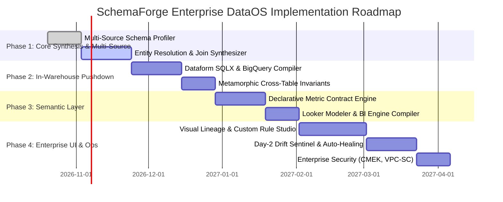

# SchemaForge (NeuroETL) — Enterprise Autonomous Data Operating System (DataOS)
## Comprehensive Knowledge Base, System Design Architecture & Engineering Roadmap

---

## PART I: EXECUTIVE KNOWLEDGE BASE

### 1.1 Executive Vision & Product Identity
**SchemaForge** is an enterprise-grade, **Autonomous Neuro-Symbolic Data Operating System (DataOS)**. It shifts enterprise data engineering from brittle, manual scripting (dbt, manual Python ETL, rigid Fivetran connectors) to **specification-driven program synthesis**.

Traditional data stacks fail because upstream SaaS vendors, databases, and APIs frequently change payload structures (schema drift), pass polymorphic fields, and introduce subtle semantic changes. SchemaForge automates the full data lifecycle:
1. **Ingestion & Conformance (Bronze $\rightarrow$ Silver):** Ingests raw, polymorphic, malformed payloads and synthesizes clean, typed, PII-masked schemas.
2. **Multi-Source Unification & Modeling (Silver $\rightarrow$ Gold):** Resolves entities across disparate systems (e.g., matching Salesforce `AccountId`, Stripe `Customer`, and SAP `KUNNR`) into unified Star Schemas.
3. **Metric & Semantic Synthesis (Gold $\rightarrow$ Metrics):** Computes business KPIs (MRR, Churn, Margin, LTV) and mathematically guarantees financial correctness before numbers reach dashboards.
4. **Day-2 Autonomous Self-Healing:** Catches schema drift, synthesizes hotfixes inside an isolated sandbox, and deploys updates without pipeline downtime.

---

### 1.2 Enterprise Problem Validation
* **Cost of Bad Data:** Enterprises lose an average of **$12.9 million annually** to bad data and pipeline downtime (Gartner); dragging the global economy by **$3.1 trillion** (HBR).
* **The Engineering Tax:** Data engineers spend **40% of their workweek** (2 full days) triaging, writing glue code, and patching broken pipelines (Monte Carlo & Wakefield Research).
* **Failure Modes of Incumbents:**
  * *Traditional ELT (Fivetran, Airbyte):* Rigid 1:1 schema replication. Dumps complex or altered JSON into raw unparsed text strings.
  * *Declarative SQL (dbt, Dataform):* Rigid DAGs. When an upstream API alters a column type or nested structure, downstream SQL models crash.
  * *Generative AI Copilots:* Brittle zero-shot prompts. They hallucinate column names, drop edge cases, and introduce silent data loss without mathematical verification.

---

### 1.3 Theoretical & Cognitive Foundation: ARC-AGI Applied to Data
SchemaForge grounds its reasoning in the **Abstraction and Reasoning Corpus (ARC-AGI)** paradigm established by François Chollet:

* **Fluid Intelligence vs. Crystallized Memorization:**
  * *Crystallized Memorization (Legacy LLM Copilots):* Regurgitates pre-trained SQL snippets. Fails on proprietary, never-before-seen enterprise schemas.
  * *Fluid Intelligence (SchemaForge):* Inductively synthesizes custom programs from input-output example pairs (Programming-by-Example / PBE), explores hypothesis spaces at test-time, and proves correctness in deterministic execution sandboxes.
* **The Invariant Gate (The Anti-Hallucination Shield):**
  Neural LLM code generation (Gemini 1.5 Pro) is strictly subordinated to a **Symbolic Verification Gate (Pandera + Metamorphic Hypothesis testing)**. Candidate code is evaluated against mathematical laws of data conservation:
  $$\sum \text{Input Financial Gross} \equiv \sum \text{Output Standardized Revenue} + \sum \text{Discounts}$$
  If a single record is dropped or corrupted, the candidate program is rejected immediately.
* **Reflexion with AST Anti-Looping:**
  Runtime errors are converted into verbal diagnostic feedback and Abstract Syntax Tree (AST) hashes, preventing the LLM from entering infinite self-repair loops.

---

## PART II: SYSTEM DESIGN ARCHITECTURE

```
┌──────────────────────────────────────────────────────────────────────────────────────────────────┐
│                                   ENTERPRISE INGESTION FABRIC                                    │
│   [SAP ERP / S4HANA]     [Salesforce / HubSpot]     [Stripe / NetSuite]     [Kafka / PubSub]     │
└───────────────────────────────────────────────┬──────────────────────────────────────────────────┘
                                                │
                                                ▼
┌──────────────────────────────────────────────────────────────────────────────────────────────────┐
│ 1. BRONZE LAYER (Raw Immutable Landing Lake)                                                     │
│    • Ingestion Services: GCP Datastream, BigQuery DTS, Cloud Pub/Sub, Cloud Storage (GCS)         │
│    • Metadata Envelope: { _tenant_id, _source, _ingested_at, _schema_fingerprint, _payload }     │
└───────────────────────────────────────────────┬──────────────────────────────────────────────────┘
                                                │
                                                ▼
┌──────────────────────────────────────────────────────────────────────────────────────────────────┐
│ 2. SCHEMA AIR-TRAFFIC CONTROLLER (Profiler & Drift Sentinel)                                     │
│    • Ingests sample batches; extracts topological trees, null ratios, and data types             │
│    • PII Sanitization via Google Cloud Sensitive Data Protection (Cloud DLP)                     │
│    • Schema Drift Sentinel triggers shadow synthesis when payloads diverge                       │
└───────────────────────────────────────────────┬──────────────────────────────────────────────────┘
                                                │
                                                ▼
┌──────────────────────────────────────────────────────────────────────────────────────────────────┐
│ 3. SILVER LAYER (Autonomous Conformance & Typing)                                                │
│    • Synthesized Dataform SQLX / Polars / PyArrow transformations                                │
│    • Standardizes UTC timestamps, ISO currencies, polymorphic JSON unnesting                     │
│    • Execution Engine: BigQuery Serverless SQL + Cloud Run micro-workers                         │
└───────────────────────────────────────────────┬──────────────────────────────────────────────────┘
                                                │
                                                ▼
┌──────────────────────────────────────────────────────────────────────────────────────────────────┐
│ 4. GOLD LAYER (Cross-Source Unification & Entity Resolution)                                     │
│    • Semantic Ontology Mapping: Aligns multi-vendor entities into Canonical Enterprise Graph     │
│    • Entity Resolution: Probabilistic Linkage (Splink/MinHash) + Deterministic Survivorship      │
│    • Dimensional Modeling: Synthesizes Kimball Star Schemas (FactOrders, DimCustomer)            │
└───────────────────────────────────────────────┬──────────────────────────────────────────────────┘
                                                │
                                                ▼
┌──────────────────────────────────────────────────────────────────────────────────────────────────┐
│ 5. METRIC & SEMANTIC LAYER (Analytics, KPIs & BI Serving)                                        │
│    • Declarative Metric Contracts: Net Revenue Retention (NRR), Churn, LTV, Gross Margin         │
│    • Invariant Gate: Metamorphic conservation tests enforce financial zero-loss guarantees       │
│    • Serving Engines: Looker Semantic Modeler, BigQuery BI Engine, High-speed REST/GraphQL APIs  │
└──────────────────────────────────────────────────────────────────────────────────────────────────┘
```

---

### 2.1 Google Cloud Platform (GCP) Services Integration Matrix

| Data OS Functional Tier | Google Cloud Component | Technical Role & Implementation |
| :--- | :--- | :--- |
| **Cognitive Brain** | **Vertex AI (Gemini 1.5 Pro & Flash)** | Inductive program synthesis, structural hypothesis generation, AST traceback diagnosis, and cross-source semantic schema matching. |
| **Execution Sandbox** | **Google Cloud Run (gVisor Containerization)** | Isolated multi-tenant execution sandbox with memory/CPU limits and zero network egress for executing untrusted candidate code. |
| **Storage Fabric** | **Google Cloud Storage (GCS) + BigQuery** | GCS acts as the immutable Bronze object store; BigQuery acts as the high-performance Silver & Gold Lakehouse. |
| **Big Data Execution** | **Dataform & BigQuery SQL** | Verified transformation logic compiles directly into Dataform SQLX and BigQuery SQL pushdown (delegating petabyte processing to Dremel). |
| **Streaming Fabric** | **Cloud Pub/Sub & Cloud Dataflow** | Cloud Pub/Sub ingests real-time webhooks; Cloud Dataflow executes streaming Apache Beam pipelines synthesized by SchemaForge. |
| **Security & Governance** | **Cloud DLP, Dataplex & Cloud KMS** | Cloud DLP masks sensitive PII; Dataplex provides centralized cataloging and OpenLineage tracking; KMS enforces Customer-Managed Encryption Keys. |
| **Orchestration** | **Cloud Composer (Airflow 3)** | Manages end-to-end DAG execution, scheduling, sensor triggers, and cross-source synchronization. |
| **Semantic & BI** | **Looker Modeler + BigQuery BI Engine** | Serves certified executive metrics with sub-second in-memory SQL execution. |

---

### 2.2 The 6-Stage Neuro-Symbolic State Machine (Execution Core)

1. **Stage 1 (Profiler):** Extracts topological JSON paths, detects polymorphic variants, computes null fractions, and identifies PII.
2. **Stage 2 (Hypothesis Generator):** Prompts Gemini 1.5 Pro to propose 3 structurally distinct transformation strategies and co-generates a formal Pandera contract.
3. **Stage 3 (Sandboxed Execution):** Executes code inside an isolated Cloud Run / gVisor sandbox against real sample records with a 5.0-second timeout ceiling.
4. **Stage 4 (Invariant Verification Gate):** Tests candidate output against Pandera schemas and Metamorphic property checks (asserting that column sums, row cardinalities, and identities balance).
5. **Stage 5 (Reflexion Repair Loop):** Captures tracebacks and cell-level diffs; uses verbal diagnostic prompts and the AST Anti-Looping Controller to self-repair failures.
6. **Stage 6 (Canonical Compiler):** Compiles verified code into Dataform SQLX packages, BigQuery views, or containerized Cloud Run microservices.

---

### 2.3 User Experience & Human-in-the-Loop Control Plane
The SchemaForge Studio provides a **"Glass-Box"** interface:
* **Visual Lineage Canvas:** Interactive node graph tracking data flow from raw vendor payloads to executive KPIs.
* **Custom Rule & Mapping Studio:**
  * *Low-Code Formula Bar:* Override or write specific column formulas (e.g. `(unit_price * qty) - discount`).
  * *Natural Language Steering Hints:* Provide domain context (e.g., *"Customer IDs prefixed with 'TEST-' are internal and must be excluded"*).
  * *Lookup Tables:* Drag-and-drop CSV crosswalk tables for mapping legacy codes to canonical standards.
* **Invariant Contract Studio:** Visual UI for declaring custom business guardrails (ranges, non-nullability, financial conservation).
* **Drift Sentinel Inbox:** Alert feed showing detected schema changes, side-by-side diffs, and 1-click approvals for sandbox-verified hotfixes.

---

## PART III: PHASED IMPLEMENTATION PLAN & ENGINEERING ROADMAP



---

### Phase 1: Multi-Source Ingestion & Entity Resolution Engine (Weeks 1–5)
* **Epic 1.1: Multi-Source Schema Profiler**
  * Extend `backend/core/profiler.py` to accept multiple simultaneous source payloads (e.g., SAP orders JSON + Stripe charges JSON + Salesforce accounts JSON).
  * Implement topological schema fingerprinting to track nested structures across heterogeneous systems.
* **Epic 1.2: Cross-Source Entity Resolution Synthesizer**
  * Update `backend/core/generator.py` to synthesize deterministic and probabilistic join keys (Splink / MinHash integration).
  * Implement survivorship rule synthesis for conflicting fields across overlapping sources.

### Phase 2: BigQuery & Dataform Pushdown Compilation (Weeks 6–10)
* **Epic 2.1: Dataform SQLX Compiler**
  * Extend `backend/core/compiler.py` to output complete Dataform Git repository structures (`definitions/silver/*.sqlx`, `definitions/gold/*.sqlx`).
  * Implement in-warehouse procedural BigQuery SQL generation for massive multi-terabyte data volume processing.
* **Epic 2.2: Cross-Table Metamorphic Invariant Engine**
  * Extend `backend/core/verifier.py` with cross-table reconciliation checks (proving $\sum \text{Source Invoices} == \sum \text{Gold Fact Table Revenue}$).
  * Implement automated cardinality explosion checks (catching accidental Cartesian $N \times M$ joins).

### Phase 3: Metric & Semantic Synthesis Layer (Weeks 11–15)
* **Epic 3.1: Declarative Metric Contract Engine**
  * Create metric contract specification schema (defining grain, dimensions, rolling windows, and accounting formulas).
  * Synthesize SQL window functions for complex cohort analytics (e.g., NRR, Churn, Customer Lifetime Value).
* **Epic 3.2: Looker Modeler & BigQuery BI Engine Integration**
  * Generate LookML views and explores directly from synthesized Gold models.
  * Auto-configure BigQuery BI Engine materialized reservations for sub-second dashboard query response times.

### Phase 4: Enterprise Control Plane UI & Day-2 Operations (Weeks 16–24)
* **Epic 4.1: Glass-Box Enterprise Web Studio**
  * Build the Visual Lineage DAG Canvas showing real-time record flow and data quality scores.
  * Implement the Interactive Mapping & Custom Rule Studio with formula bars and natural language steering hints.
* **Epic 4.2: Drift Sentinel & Cascading Self-Healing**
  * Implement background event listeners (GCS / Eventarc) to detect schema drift automatically.
  * Implement the Canary Sandbox runner: automatically tests schema patches against 5% production slices and generates pull requests.
* **Epic 4.3: Enterprise Hardening & Zero-Trust Security**
  * Integrate Google Cloud KMS Customer-Managed Encryption Keys (CMEK).
  * Configure VPC Service Controls (VPC-SC) and enforce automated Cloud DLP masking at Bronze entry.
