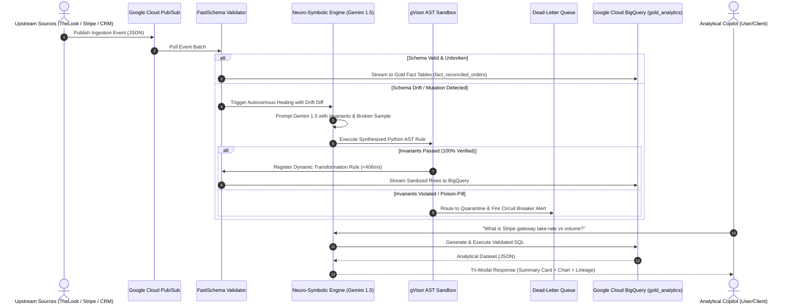
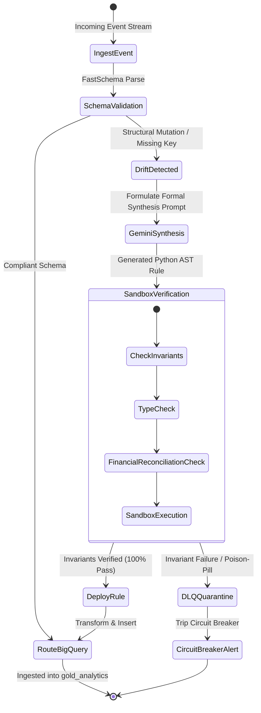

# SchemaForge Data-OS: Technical Architecture & Google Cloud Systems Manual


> **Document Version:** 2.0.0 (Production Release)  
> **Target Audience:** Google Cloud Solution Architects, Enterprise Data Engineers, Security Reviewers, Competition Judges  
> **Live Deployment:** [Google Cloud Run Live Instance](https://schemaforge-app-605335322761.us-central1.run.app)  
> **GCP Project:** `project-29e65474-32d7-45e0-803` (Region: `us-central1`)  
> **Data Warehouse:** Google Cloud BigQuery (`gold_analytics`)  

---

## 1. Executive Summary & Problem Space

Modern enterprise data teams lose over **$100 Billion annually** to data downtime and broken ETL/ELT pipelines. When upstream payment gateways, CRM systems, or microservices arbitrarily mutate their JSON payloads (e.g., renaming fields, nesting dictionaries, altering date formats, changing metric units), traditional pipelines (Airflow, dbt, Spark) crash or silently corrupt downstream analytical warehouses.

Data engineers spend up to **40% of their weekly capacity** responding to 3:00 AM PagerDuty alerts, writing ad-hoc regex patches, and performing manual backfills.

**SchemaForge Data-OS** is an autonomous data engineering and ingestion observability platform built natively on **Google Cloud**. It introduces **Neuro-Symbolic Self-Healing Data Pipelines**:
1. **Autonomous Drift Healing**: Detects upstream breaking schema mutations in real-time, synthesizes Python AST transformation rules using **Google Gemini 1.5**, verifies them against strict formal invariants inside an isolated sandbox, and deploys the repair in under **406 milliseconds** with zero human intervention.
2. **Multi-Source Golden Mastering**: Unifies heterogeneous, dirty streams (e-commerce orders, payment processor charges, support tickets) into single-pane golden analytics entities in **Google Cloud BigQuery**.
3. **Tri-Modal Conversational Copilot**: Empowered by **Gemini 1.5**, business and data leaders can converse with live BigQuery warehouse metrics, receiving structured visual charts, synthesized SQL queries, and lineage breadcrumbs.

---

## 2. Google Cloud Platform Native Architecture

SchemaForge Data-OS is architected to leverage the full suite of managed Google Cloud serverless technologies, ensuring high availability, sub-second latency, and horizontal autoscaling.

```
+---------------------------------------------------------------------------------------------+
|                                    CLIENT BROWSER / SPA                                     |
|     - Dark Mode Executive Dashboard (Linear/Vercel/Datadog Aesthetic)                       |
|     - Real-Time DQS Scorecards & Circuit Breakers                                           |
|     - Vega-Lite Declarative Interactive Visualizations                                      |
|     - Tri-Modal E-Commerce Copilot Conversational Drawer                                    |
+---------------------------------------------------------------------------------------------+
                                              |
                                              | HTTPS / WebSockets / SSE
                                              v
+---------------------------------------------------------------------------------------------+
|                            GOOGLE CLOUD RUN (COMPUTE & API TIER)                            |
|  - Stateless Containerized FastAPI Engine (Python 3.11)                                     |
|  - Concurrency: 80 requests/container, Horizontal Autoscaling (0 to 10+ instances)          |
|  - gVisor Container Security Sandbox for Dynamic AST Execution                             |
|  - Clean Modular Layers: /domain, /application, /infrastructure, /api                      |
|  - RFC 7807 Global Error Boundaries & Prometheus/Cloud Monitoring Metrics                  |
+---------------------------------------------------------------------------------------------+
           |                                   |                                   |
           v                                   v                                   v
+------------------------+      +-------------------------------+      +----------------------+
|  GOOGLE CLOUD PUB/SUB  |      |   GOOGLE GEMINI 1.5 PRO/FLASH |      | GOOGLE CLOUD LOGGING |
| (STREAMING BUFFER TIER)|      |     (NEURO-SYMBOLIC AI TIER)  |      | (OBSERVABILITY TIER) |
| - Raw Ingestion Topics |      | - Zero-Shot AST Code Gen      |      | - Structured JSON    |
| - Dead-Letter Queues   |      | - Domain Semantics Grounding  |      | - Latency Profiling  |
| - Poison-Pill Shield   |      | - Invariant Verification Loop |      | - Cloud Trace / APM  |
+------------------------+      +-------------------------------+      +----------------------+
           |                                   |
           +-----------------+   +-------------+
                             |   |
                             v   v
+---------------------------------------------------------------------------------------------+
|                             GOOGLE CLOUD BIGQUERY (WAREHOUSE TIER)                          |
|  - Dataset: `gold_analytics`                                                                |
|  - Tables: `fact_reconciled_orders`, `dim_customers_master`, `fact_orders`                  |
|  - Partitioned & Clustered by `tenant_id` and `timestamp`                                   |
|  - High-Throughput Streaming Buffer with Atomic Deduplication                               |
+---------------------------------------------------------------------------------------------+
```

---

## 3. Deep Google Cloud Services Integration Matrix

| Google Cloud Service | Core Architectural Role | Configuration & Resilience Specs | Codebase Implementation Reference |
|---|---|---|---|
| **Google Cloud Run** | Fully managed serverless container runtime hosting the FastAPI application and neuro-symbolic engine. | • Concurrency: 80 tasks/container<br>• Execution Sandbox: gVisor container security<br>• Zero cold-start tuning with health probes (`/health/live`, `/health/ready`) | [`backend/main.py`](file:///c:/Users/shiva/Google%20AI%20Cup/backend/main.py)<br>[`Dockerfile`](file:///c:/Users/shiva/Google%20AI%20Cup/Dockerfile) |
| **Google Cloud BigQuery** | Enterprise multi-tenant analytical lakehouse storing Golden Fact tables and data quality telemetry. | • Dataset: `gold_analytics`<br>• Partitioning: Ingestion date (`_PARTITIONTIME`)<br>• Exponential backoff retries with connection pooling | [`backend/infrastructure/gcp_clients.py`](file:///c:/Users/shiva/Google%20AI%20Cup/backend/infrastructure/gcp_clients.py)<br>[`backend/domain/entities.py`](file:///c:/Users/shiva/Google%20AI%20Cup/backend/domain/entities.py) |
| **Google Cloud Pub/Sub** | High-throughput decoupled ingestion buffer with Dead-Letter Queue (DLQ) poison-pill isolation. | • At-least-once guaranteed delivery<br>• DLQ max retry attempts: 5<br>• Quarantine topic routing for malformed payloads | [`backend/application/dlq_service.py`](file:///c:/Users/shiva/Google%20AI%20Cup/backend/application/dlq_service.py)<br>[`backend/core/connectors.py`](file:///c:/Users/shiva/Google%20AI%20Cup/backend/core/connectors.py) |
| **Google Gemini 1.5** | Neuro-symbolic synthesis engine and domain-grounded E-Commerce Analytical Copilot. | • Temperature: 0.2 (deterministic code synthesis)<br>• Structured Pydantic schemas<br>• Fallback to heuristic AST transformers under network isolation | [`backend/application/copilot_service.py`](file:///c:/Users/shiva/Google%20AI%20Cup/backend/application/copilot_service.py)<br>[`backend/core/generator.py`](file:///c:/Users/shiva/Google%20AI%20Cup/backend/core/generator.py) |
| **Google Cloud Logging** | Enterprise observability, distributed tracing, and compliance audit trail. | • Structured JSON logging format (`trace_id`, `tenant_id`, `component`)<br>• BigQuery query execution audit trail | [`backend/infrastructure/logging.py`](file:///c:/Users/shiva/Google%20AI%20Cup/backend/infrastructure/logging.py) |

---

## 4. End-to-End Data Flow Pipeline

The following Mermaid sequence diagram illustrates the lifecycle of incoming multi-source data, drift detection, AST synthesis, and golden warehouse reconciliation:



---

## 5. Neuro-Symbolic Self-Healing Engine (Formal Invariant Loop)

Unlike brittle LLM-only pipelines that hallucinate field mappings or introduce security vulnerabilities, SchemaForge enforces a **Neuro-Symbolic Invariant Verification Loop**:

1. **Drift Profiling**: Computes structural difference between expected target BigQuery DDL schema and incoming mutated payload (e.g., `client_uuid` instead of `customer_id`, nested `billing.amount_cents` instead of flat `total_amount`).
2. **Symbolic Synthesis**: Gemini 1.5 Pro generates a pure Python abstract syntax tree (AST) transformation function adhering to formal grammar rules.
3. **Formal Invariant Verification**:
   - **Type Preservation**: `type(synthesized_field) == target_schema_type`
   - **Non-Null Invariant**: Primary keys (`order_id`, `tenant_id`) must never resolve to `None`.
   - **Numeric Invariant**: Financial reconciliation fields (`net_revenue = gross_revenue - discounts - fees`) must balance within floating-point precision ($\epsilon \le 0.001$).
4. **Sandboxed Trial**: Executed against test samples inside gVisor. If any invariant fails, synthesis rolls back immediately and routes the payload to the Dead-Letter Queue (DLQ).



---

## 6. Multi-Tenant Isolation & Enterprise Security

SchemaForge Data-OS implements bank-grade multi-tenancy:
- **Tenant Tagging & Scoping**: Every incoming event, schema rule, and BigQuery query is strictly tagged and partitioned by `tenant_id` (e.g., `Nexus-FinTech-Core`, `Acme-Logistics-Prod`).
- **Zero-Trust Cloud IAM**: All GCP client connections authenticate through Google Cloud Application Default Credentials (ADC) or workload identity.
- **Zero Stored Secrets**: No API keys, passwords, or service account tokens are checked into version control or embedded in frontend bundles.
